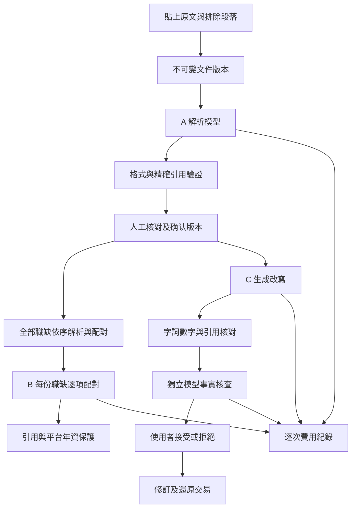

# 元件、資料流與模型邊界

## 技術分工

Next.js（網頁全端框架）16.3.8 的 App Router（檔案式路由）提供頁面及後端入口。React（互動元件）19.3.0 搭配 TypeScript（型別檢查）嚴格模式。SQLite（本機單檔資料庫）以 better-sqlite3（同步驅動）存取。單機、小資料量不需要額外 ORM（物件資料映射）、向量資料庫或代理框架。

頁面為伺服器元件；互動工作台為瀏覽器元件，經同源後端取得初始資料。伺服器設定、資料庫與模型模組都只被後端入口引用。模型金鑰不使用公開環境變數，不傳入頁面屬性。

| 模組 | 責任 |
|---|---|
| src/components/AppContext.tsx（應用狀態） | reducer（狀態轉換）、跨頁履歷選擇、同源請求、串流階段、取消、錯誤與原文面板 |
| src/components/Home.tsx（工作台） | 搜尋、地點／方式／狀態篩選、收藏、文件入口 |
| ResumeWorkspace（履歷準備區） | 選定比對履歷、事實核對入口與補充來源；補充來源不置於職缺區 |
| JobCard（職缺卡片） | 統一結果入口、整批逐筆狀態、三狀態摘要與原文管理 |
| job-progress（畫面進度選擇器） | 分開解析核對與配對狀態，檢查履歷、職缺、模式及版本，避免顯示另一份履歷或過期結果 |
| DocumentForm（原文表單） | 長度、保存同意、段落排除、原文版本更新 |
| ReviewView（解析核對） | 人工文字、分類、平台、年資及來源修正；新增補充事實引用 |
| AnalysisView（條件分析） | 必要／加分／未明示條件、逐項狀態、缺口、輸入預覽 |
| RewriteView（改寫核對） | 原文與提案並列、逐項主張、阻擋、接受拒絕與還原 |
| CompareView（職缺比較） | 最多三個職缺逐條並列；手機展開卡片 |
| SettingsView（資料與用量） | 模式與保存位置、外傳政策、逐次費用、執行紀錄與清除 |
| primitives（共用基本元件） | 原生對話框焦點限制、關閉後回復、引用按鈕及原文高亮 |
| src/domain（領域資料） | 契約、来源定位、事實與平台保護、串流解碼、合成範例 |
| src/server/repository.ts（資料操作） | 文件版本、雜湊、快取依據、防重複操作交易 |
| src/server/services.ts（應用操作） | 核對修正、接受／拒絕、還原及刪除 |
| src/server/model（模型處理） | 提示、固定／真實配接器、輸出、引用、事實驗證與用量 |
| BatchPanel（整批比對區） | 一次履歷確認、全部職缺範圍、完成／失敗統計與整批更新 |
| src/server/batches.ts（整批管理） | 清單快照、依序執行、額度等待、取消、恢復與逐筆失敗保存 |
| src/server/runs.ts（執行管理） | 單一並行、取消、有限重試、版本及資料世代檢查 |
| src/server/security.ts（本機安全） | 回環主機、同源、HTTP Only（瀏覽器腳本不可讀）工作階段 |

## 資料流

模型配接器不修改履歷。接受操作確認來源版本、人工核對版、目前修訂與檢查結果，交易中新增修訂；重複操作代碼回傳原結果，不多寫一次。還原也新增版本，保留決定歷程。

## 資料模型與來源

九張資料表分別保存文件、版本、核對、執行、分析、改寫、修訂、用量及整批狀態，以識別碼及經驗證的 JSON（結構資料）保存。另有操作代碼與資料世代。資料來源及邊界由服務層檢查，值均使用參數化查詢；表名只能是固定聯集。

原文保留貼上版本，分析文字只統一換行。每個非空行是來源片段；長行優先沿標點／空白拆段，不切英文單字。演算法為來源定位第一版；每個片段含固定識別碼、行號與 UTF-16（JavaScript 字串位置）起訖。模型只給識別碼與精確引句，後端必須在允許段落唯一找到引句，才計算位置。

重複短引句、不存在、排除段落、來源版本與位置不一致均拒絕。使用者可選整個來源片段作為人工修正依據。新事實先建立使用者補充文件；已接受文字不升格為來源。更新原文建立新不可變版本，使核對及分析過期。

## 快取、並行與恢復

分頁工作階段只記住選定履歷識別碼。重新讀取工作區時確認該識別碼仍對應履歷；已刪除時回到第一份可用履歷或空狀態。選擇履歷、頁面導覽與篩選只讀已有資料，不發起模型操作。首頁整批入口由後端依序調度原有解析與配對任務，維持單一並行及快取。履歷確認後才啟動；職缺條件允許待人工核對的初步配對，改寫仍需兩份資料確認。

快取包含任務輸入、文件版本與雜湊、人工核對版、目前修訂、模型設定指紋、提示、契約、驗證器版本。真實／固定隔離；僅重用完成結果，最多七天。切換頁面只讀資料，不呼叫模型。配置改變後不重用舊模型快取。

配對只依來源及確認事實，接受／還原後不把改寫修訂算進配對快取；改寫任務才包含目前修訂。重複確認相同內容不增加核對版，避免沒有事實變更卻使分析過期。

本機一個模型任務並行，每分鐘最多六次實際上游請求，包含獨立核查與重試。重新整理工作台查原執行，程序重啟把未完成任務標為中斷，不自動再次付費。重新整理的前端不重新送出任務。

清除先取消執行，在交易中刪除資料並增加資料世代，遲到回應不能保存結果及用量。資料庫啟用 secure_delete（覆寫刪除頁面）、清理 WAL（交易日誌）及整理空間；不保證抹除系統備份或磁碟底層殘留。

## 資料及部署邊界

唯一本機設定為根目錄 .env（環境設定檔），金鑰與資料排除版本控制及伺服器打包追蹤。資料庫不是瀏覽器可讀檔案。啟動綁 127.0.0.1（本機回環），寫入需同源、有效工作階段及 JSON 格式。此版不提供多使用者身分驗證。

没有公開部署、雲端資料同步、平台帳號、發送訊息、自動投遞或爬蟲。個人資料只在使用者啟動模型操作時傳往 xAI。供應商保存政策與本機清除是不同範圍。

## 錄影與播放

scripts/recording-environment.ts（隔離錄影環境）複製必要程式，建立空資料庫，以 localhost:3002（隔離服務）執行合成流程；結束後移除暫存金鑰設定，保留去機密費用證據。錄影結果不覆寫本人資料庫。scripts/serve-recordings.ts（影片服務）只綁定本機 3003，依固定允許清單提供影片、字幕、合成截圖及用量摘要，支援部分內容傳送；不暴露設定或資料庫。
